# Bloco de Notas — Turma B

Aplicativo Flutter de bloco de notas com **armazenamento local (SQLite)** e
**sincronização com a nuvem (Firebase Cloud Firestore)**. O usuário entra com
e-mail e senha, cria notas organizadas por categorias, pesquisa pelo título ou
conteúdo e recupera notas excluídas pela lixeira. As notas continuam
funcionando sem internet e são enviadas para a nuvem quando a conexão volta.

**Objetivo:** evoluir o bloco de notas desenvolvido em aula, integrando o banco
local com o Firebase e aplicando boas práticas de arquitetura e de uso do Git.

---

## Sumário

1. [Funcionalidades](#1-funcionalidades)
2. [Tecnologias e dependências](#2-tecnologias-e-dependências)
3. [Como instalar e executar](#3-como-instalar-e-executar)
4. [Configuração do Firebase](#4-configuração-do-firebase)
5. [Arquitetura e organização dos arquivos](#5-arquitetura-e-organização-dos-arquivos)
6. [Padrões de projeto adotados](#6-padrões-de-projeto-adotados)
7. [Armazenamento local e integração com o Firebase](#7-armazenamento-local-e-integração-com-o-firebase)
8. [Estratégia de sincronização e tratamento de erros](#8-estratégia-de-sincronização-e-tratamento-de-erros)
9. [Autenticação e segurança dos dados](#9-autenticação-e-segurança-dos-dados)
10. [Testes](#10-testes)
11. [Capturas de tela](#11-capturas-de-tela)
12. [O que foi alterado nesta entrega](#12-o-que-foi-alterado-nesta-entrega)

---

## 1. Funcionalidades

| Funcionalidade | Descrição |
| --- | --- |
| **Cadastro e login** | Conta com e-mail e senha (Firebase Authentication). A sessão fica salva: ao reabrir o app o usuário já entra direto nas notas. |
| **CRUD de notas** | Criar, listar, editar e excluir notas, gravando no SQLite e no Firestore. |
| **Notas por usuário** | Cada nota guarda o `uid` do dono. No aparelho as consultas filtram pelo `uid`; na nuvem cada usuário só acessa `users/{seu uid}`. |
| **Sincronização** | Notas e categorias são enviadas e baixadas da nuvem. Ao entrar em outra instalação, as notas da conta aparecem. |
| **Funciona offline** | Sem internet tudo é salvo no SQLite e fica marcado como pendente; o ícone de nuvem mostra o estado e as pendências são enviadas depois. |
| **Categorias** | Categorias padrão (Geral, Estudos, Trabalho, Pessoal) e categorias criadas pelo usuário. Cada nota tem uma categoria. |
| **Filtro por categoria** | Chips no topo da lista filtram as notas por categoria. |
| **Pesquisa** | Busca pelo título ou conteúdo, combinável com o filtro de categoria, mostrando a quantidade de resultados. |
| **Funcionalidade adicional: Lixeira com recuperação** | Excluir uma nota move para a lixeira (com opção "Desfazer"). Na lixeira é possível restaurar, excluir definitivamente ou esvaziar. Notas com mais de 30 dias na lixeira são excluídas automaticamente. A lixeira também é sincronizada. |
| **Extra: Ordenação por data** | Ordena por última atualização, data de criação (mais recentes ou mais antigas) ou título. |

---

## 2. Tecnologias e dependências

| Tecnologia | Uso |
| --- | --- |
| [Flutter](https://flutter.dev) / Dart `^3.12` | Framework e linguagem do app |
| `firebase_core` | Inicialização do Firebase |
| `firebase_auth` | Login e cadastro com e-mail e senha |
| `cloud_firestore` | Banco de dados na nuvem |
| `sqflite` | Banco de dados local SQLite |
| `path` | Montagem do caminho do arquivo do banco |
| `flutter_lints` / `flutter_test` | Análise estática e testes |

As versões exatas estão em [`pubspec.yaml`](pubspec.yaml) e
[`pubspec.lock`](pubspec.lock).

> **Plataformas:** o app foi feito para **Android** (e iOS). O pacote
> `sqflite` não funciona na Web nem no Windows sem adaptações, por isso use um
> emulador Android ou um celular.

---

## 3. Como instalar e executar

### Pré-requisitos

- Flutter SDK instalado (`flutter doctor` sem erros para Android)
- Android Studio com um emulador, ou um celular Android com depuração USB
- Uma conta Google para o Firebase (veja a seção 4)

### Passo a passo

```bash
# 1. Clonar o repositório e entrar na branch de desenvolvimento
git clone https://github.com/cumbuca13/bloco_de_nota_turma_B.git
cd bloco_de_nota_turma_B
git checkout desenvolvimento

# 2. Instalar as dependências
flutter pub get

# 3. (Opcional) Configurar o seu próprio projeto Firebase — seção 4

# 4. Executar no emulador/celular
flutter run

# Rodar análise estática e testes
flutter analyze
flutter test
```

---

## 4. Configuração do Firebase

O repositório já aponta para o projeto Firebase `notepad-cumbuca` (arquivos
`lib/firebase_options.dart` e `android/app/google-services.json`). Para usar o
**seu próprio** projeto Firebase:

1. Acesse o [Console do Firebase](https://console.firebase.google.com) e crie
   um projeto.
2. **Authentication** → *Começar* → aba *Sign-in method* → ative
   **E-mail/senha**.
3. **Firestore Database** → *Criar banco de dados* → escolha a região →
   inicie em **modo de produção** (as regras deste projeto serão publicadas a
   seguir).
4. Instale as ferramentas de linha de comando (no **CMD/PowerShell**):

   ```bash
   npm install -g firebase-tools
   firebase login
   dart pub global activate flutterfire_cli
   ```

5. Na pasta do projeto, gere a configuração do app:

   ```bash
   flutterfire configure
   ```

   Esse comando cria/atualiza `lib/firebase_options.dart`,
   `android/app/google-services.json` e `firebase.json` com os dados do seu
   projeto.

6. Publique as regras de segurança do arquivo [`firestore.rules`](firestore.rules):

   ```bash
   firebase deploy --only firestore:rules --project SEU_PROJECT_ID
   ```

   Ou copie o conteúdo de `firestore.rules` em **Firestore → Regras** no
   console e clique em **Publicar**.

7. Execute `flutter run`.

> ℹ️ `firebase_options.dart` e `google-services.json` contêm apenas
> **identificadores públicos** do projeto (ID do projeto, ID do app e chave de
> API do cliente). Segundo a documentação do Firebase, eles não são senhas: a
> proteção dos dados é feita pelo **Firebase Authentication** e pelas
> **regras do Firestore**. Nenhuma senha, chave privada ou conta de serviço
> (`service-account.json`) está no repositório. Como medida extra, a chave de
> API pode ser restringida ao app Android no
> [Google Cloud Console](https://console.cloud.google.com/apis/credentials).

---

## 5. Arquitetura e organização dos arquivos

O app segue uma arquitetura em camadas, com o fluxo
**Tela → Repositório → (SQLite | Firestore)**. As telas nunca acessam o
banco ou o Firebase diretamente.

```
┌───────────────────────────── Interface (screens / widgets) ─────────────────────────────┐
│  LoginPage  RegisterPage  NotesPage  NoteFormPage  TrashPage  NoteCard  SyncStatusButton │
└───────────────────────────────────────────┬─────────────────────────────────────────────┘
                                            │ chama
                              ┌─────────────▼─────────────┐
                              │      NoteRepository        │  ← ponto único de acesso
                              │ (lê/grava local + dispara  │    aos dados
                              │       sincronização)       │
                              └──────┬──────────────┬──────┘
                                     │              │
                       ┌─────────────▼───┐   ┌──────▼────────┐
                       │ DatabaseHelper  │◄──┤  SyncService  │  ← envia pendências e
                       │    (SQLite)     │   │ (push + pull) │    baixa da nuvem
                       └─────────────────┘   └──────┬────────┘
                                                    │
                                          ┌─────────▼─────────┐
                                          │ FirestoreService  │ ──► Cloud Firestore
                                          └───────────────────┘
```

```
lib/
├── main.dart                     # Inicializa o Firebase, tema e AuthGate (login x notas)
├── firebase_options.dart         # Configuração gerada pelo FlutterFire CLI
├── models/
│   ├── note.dart                 # Modelo Note + SyncStatus + conversões SQLite/Firestore
│   └── note_category.dart        # Modelo NoteCategory + categorias padrão
├── database/
│   └── database_helper.dart      # SQLite: tabelas, migração, consultas, pesquisa e ordenação
├── services/
│   ├── auth_service.dart         # Firebase Auth + mensagens de erro em português
│   ├── firestore_service.dart    # Leitura/gravação no Firestore + tradução de erros
│   └── sync_service.dart         # Algoritmo de sincronização e resolução de conflitos
├── repositories/
│   └── note_repository.dart      # API usada pelas telas; estado da sincronização
├── screens/
│   ├── login_page.dart
│   ├── register_page.dart
│   ├── notes_page.dart           # Lista, pesquisa, filtro por categoria, ordenação
│   ├── note_form_page.dart       # Criar/editar nota e escolher/criar categoria
│   └── trash_page.dart           # Lixeira: restaurar, excluir de vez, esvaziar
├── widgets/
│   ├── note_card.dart            # Cartão da nota (categoria, data, ícone de pendência)
│   ├── sync_status_button.dart   # Ícone de nuvem com o estado da sincronização
│   └── new_category_dialog.dart  # Diálogo para criar categoria
└── utils/
    ├── id_generator.dart         # Gera IDs no formato do Firestore, mesmo offline
    └── date_format.dart          # Formata datas dd/MM/yyyy HH:mm
test/
└── sync_logic_test.dart          # Testes do modelo e da resolução de conflitos
firestore.rules                   # Regras de segurança do Firestore
firebase.json                     # Configuração do Firebase CLI (inclui as regras)
```

---

## 6. Padrões de projeto adotados

| Padrão | Onde | Por quê |
| --- | --- | --- |
| **Repository** | `repositories/note_repository.dart` | As telas pedem "as notas do usuário" sem saber se vêm do SQLite ou do Firestore. Toda a regra de "gravar local, marcar pendente e sincronizar" fica em um só lugar, então as telas ficaram mais simples e a estratégia de armazenamento pode mudar sem mexer na interface. |
| **Singleton** | `DatabaseHelper.instance`, `NoteRepository.instance` | Garante uma única conexão aberta com o `notes.db` e um único estado de sincronização compartilhado por todas as telas (a lista e a lixeira enxergam o mesmo status). |
| **Observer** | `AuthGate` (`StreamBuilder` em `authStateChanges`), `NoteRepository.syncInfo` e `changes` (`ValueNotifier`), `SyncStatusButton` (`ValueListenableBuilder`) | A interface reage sozinha a eventos: o login/logout troca a tela automaticamente; o ícone de nuvem muda quando a sincronização começa/termina; a lista recarrega quando chegam notas da nuvem. |
| **Service Layer** | `AuthService`, `FirestoreService`, `SyncService` | Isola cada responsabilidade externa (autenticação, acesso à nuvem, algoritmo de sincronização), facilitando testes e manutenção. |
| **Mapper / DTO** | `Note.toMap/fromMap` e `Note.toFirestore/fromFirestore` | Converte o modelo para o formato de cada banco. Campos só locais (`id`, `sync_status`) não vão para a nuvem. |
| **Offline-first** | `NoteRepository` + `SyncService` | O SQLite é a fonte de dados da interface; a nuvem é sincronizada em segundo plano. O app continua utilizável sem internet. |
| **Injeção de dependência (por construtor)** | `SyncService({local, remote})`, `FirestoreService({firestore})` | Permite trocar as dependências por versões falsas em testes. |

---

## 7. Armazenamento local e integração com o Firebase

### SQLite (`notes.db`)

Tabela **`notes`**

| Coluna | Tipo | Descrição |
| --- | --- | --- |
| `id` | INTEGER PK | Chave local |
| `remote_id` | TEXT UNIQUE | ID do documento no Firestore (gerado no aparelho) |
| `uid` | TEXT | Dono da nota (Firebase Auth) |
| `title`, `content` | TEXT | Título e conteúdo |
| `category` | TEXT | Nome da categoria |
| `created_at`, `updated_at` | INTEGER | Datas em milissegundos |
| `deleted_at` | INTEGER NULL | Preenchido = nota na lixeira |
| `sync_status` | TEXT | `synced`, `pending` ou `pendingDelete` |

Tabela **`categories`**: `id`, `remote_id`, `uid`, `name`, `sync_status`
(com `UNIQUE(uid, name)`).

O banco está na **versão 2**. Quem tinha a versão 1 (da aula) passa por uma
migração automática em `_upgradeDB`: as notas antigas são copiadas para o
novo formato, recebem um `remote_id` e ficam pendentes para subir na
próxima sincronização.

**Pesquisa:** feita no SQLite com
`title LIKE ? OR content LIKE ?` (sem diferenciar maiúsculas de minúsculas,
com `%` e `_` digitados tratados como texto). Como todas as notas da nuvem são
baixadas para o SQLite na sincronização, a pesquisa encontra tanto as notas
criadas neste aparelho quanto as vindas de outras instalações — e funciona
offline.

### Cloud Firestore

```
users/{uid}/notes/{remoteId}
    uid, title, content, category, createdAt, updatedAt, deletedAt
users/{uid}/categories/{remoteId}
    uid, name
```

A **mesma chave** (`remote_id`) identifica a nota nos dois bancos. Ela é
gerada no aparelho (`utils/id_generator.dart`) no momento da criação, então
uma nota criada offline já nasce com o ID que terá na nuvem, e reenviar a
mesma nota nunca cria duplicatas.

O cache offline do próprio Firestore foi **desativado** em `main.dart`
(`persistenceEnabled: false`), porque o SQLite já cumpre esse papel. Assim há
uma única fonte local de dados e a sincronização é controlada pelo código do
app, não pelo SDK.

---

## 8. Estratégia de sincronização e tratamento de erros

### Quando sincroniza

- Ao abrir a tela de notas (após login ou ao reabrir o app);
- Logo após qualquer gravação (criar, editar, mover para lixeira, restaurar,
  excluir, criar categoria), em segundo plano;
- Manualmente, tocando no **ícone de nuvem** ou **puxando a lista para baixo**.

Uma trava em `SyncService.sync` impede duas sincronizações simultâneas.

### Como sincroniza (`services/sync_service.dart`)

1. **Gravação local:** toda alteração vai para o SQLite com
   `sync_status = pending` (ou `pendingDelete` na exclusão definitiva) e
   `updated_at = agora`.
2. **Envio (push):** cada registro pendente é gravado no Firestore com
   `set()` no documento `remote_id`. Só após a confirmação do servidor o
   registro vira `synced`. Na exclusão definitiva, o documento é apagado na
   nuvem e só então a linha some do SQLite.
3. **Recebimento (pull):** todas as notas e categorias do usuário são lidas do
   servidor e comparadas com as locais pela função `resolveMerge`:

| Situação | Ação |
| --- | --- |
| Existe só na nuvem | Baixa para o SQLite |
| Local `synced` e diferente da nuvem | A versão da nuvem substitui a local |
| Local `synced` mas não existe mais na nuvem | Foi excluída em outro aparelho → apaga localmente |
| Local `pending` e a nuvem tem versão **mais nova** | Nuvem vence (última gravação vence) |
| Local `pending` e mais nova (ou não existe na nuvem) | Mantém a local; será enviada |

A lixeira também é sincronizada: mover para a lixeira é apenas uma alteração do
campo `deletedAt`, então a nota aparece na lixeira em todos os aparelhos.

### Tratamento de erros

- `FirestoreService` aplica um **tempo limite de 10 s** em cada operação e
  lê com `Source.server`, para detectar a falta de conexão em vez de esperar
  indefinidamente.
- Erros do Firebase são traduzidos em `RemoteException` com mensagem em
  português: sem conexão (`unavailable`, tempo esgotado), acesso negado pelas
  regras (`permission-denied`), sessão expirada (`unauthenticated`) etc.
- Se falhar no meio, **nada se perde**: o que não foi confirmado continua
  pendente no SQLite e é reenviado na próxima tentativa.
- A interface informa o usuário:
  - ícone de nuvem: ✅ sincronizado · ⬆️ pendências · ⛔ offline · ❗ erro
    (o texto do botão mostra os detalhes);
  - aviso com o botão **"Tentar de novo"** quando a sincronização falha;
  - ícone de nuvem com seta em cada nota ainda não enviada;
  - ao sair da conta com alterações pendentes, um aviso pede confirmação.
- No login/cadastro, os erros (`network-request-failed`, senha incorreta,
  e-mail já usado, senha fraca...) aparecem com mensagens claras
  (`AuthService.friendlyError`).

---

## 9. Autenticação e segurança dos dados

- **Autenticação:** Firebase Authentication com e-mail e senha. O `AuthGate`
  (`main.dart`) mostra o login para quem não está autenticado e as notas para
  quem está.
- **Isolamento no aparelho:** todas as consultas do SQLite filtram por `uid`,
  então duas contas no mesmo celular não veem as notas uma da outra.
- **Isolamento na nuvem — [`firestore.rules`](firestore.rules):**
  - só usuários autenticados acessam dados;
  - cada usuário só lê, cria, altera e exclui documentos em
    `users/{seu próprio uid}/...` (`request.auth.uid == uid`);
  - na gravação, o campo `uid` do documento precisa ser o do próprio usuário,
    e os campos são validados (somente os campos esperados, tipos corretos,
    título até 200 caracteres, conteúdo até 20.000, categoria até 30);
  - qualquer outro caminho do banco é bloqueado (`allow read, write: if false`).
- **Sem segredos no repositório:** não há senhas, chaves privadas nem contas de
  serviço. Os arquivos de configuração do Firebase contêm apenas
  identificadores públicos (ver nota na seção 4).

**Como testar as regras:** no console do Firebase, em **Firestore → Regras →
Playground de regras**, simule uma leitura de
`users/UID_DE_OUTRO_USUARIO/notes/qualquer` autenticado com outro UID: o
resultado deve ser **negado**.

---

## 10. Testes

```bash
flutter test
```

`test/sync_logic_test.dart` cobre a conversão do modelo (SQLite ⇄ Firestore),
a geração de IDs e todos os casos da regra de conflito `resolveMerge`.

### Roteiro de teste manual da sincronização

1. Entre com uma conta e crie notas → o ícone fica ✅ e as notas aparecem no
   console do Firestore em `users/{uid}/notes`.
2. Ative o **modo avião**, crie/edite uma nota → o app avisa que está offline e
   a nota mostra o ícone de pendência.
3. Desative o modo avião e puxe a lista para baixo → as pendências são
   enviadas e aparecem no Firestore.
4. Desinstale o app (ou use outro emulador), instale de novo e entre com a
   mesma conta → as notas são baixadas da nuvem.
5. Entre com outra conta → nenhuma nota da primeira conta aparece.

---

## 11. Capturas de tela

> As imagens ficam na pasta [`docs/screenshots`](docs/screenshots).

### Autenticação

| Login | Cadastro | Lista vazia (sincronizado ✅) |
| --- | --- | --- |
| 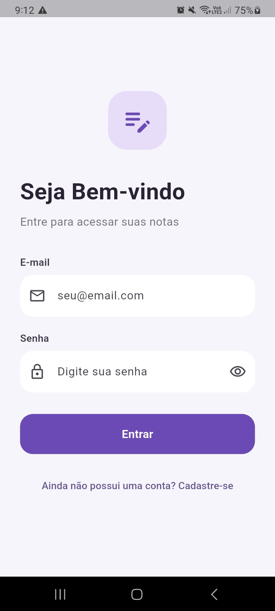 | 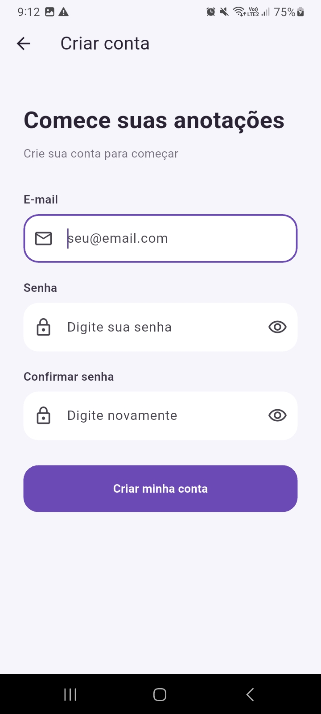 | 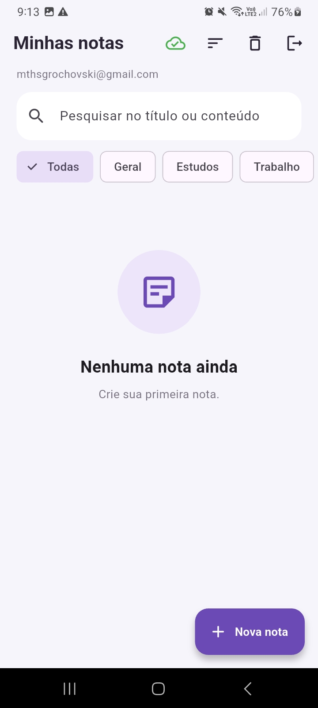 |

### Notas e categorias

| Lista com categorias | Nova nota | Editar nota (seleção de categoria) |
| --- | --- | --- |
| 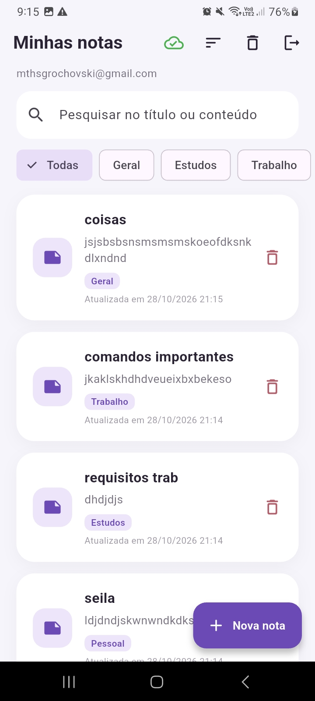 | 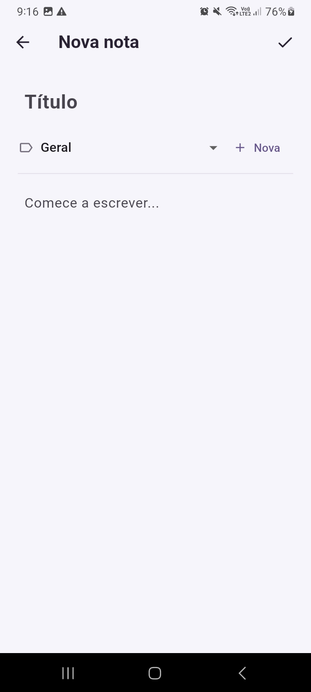 | 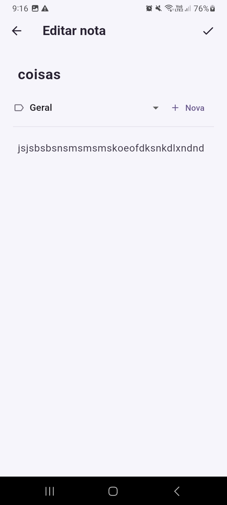 |

### Filtro por categoria

| Estudos | Trabalho | Pessoal |
| --- | --- | --- |
| 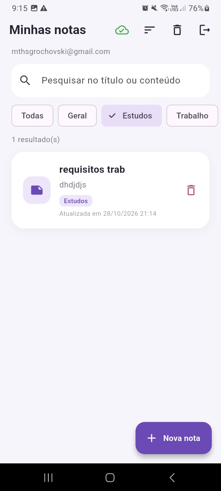 | 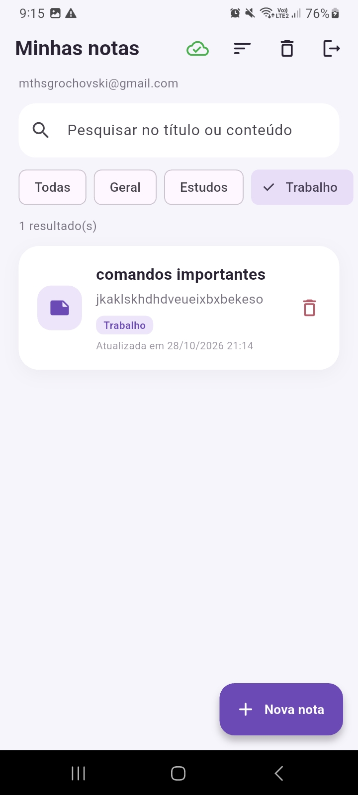 | 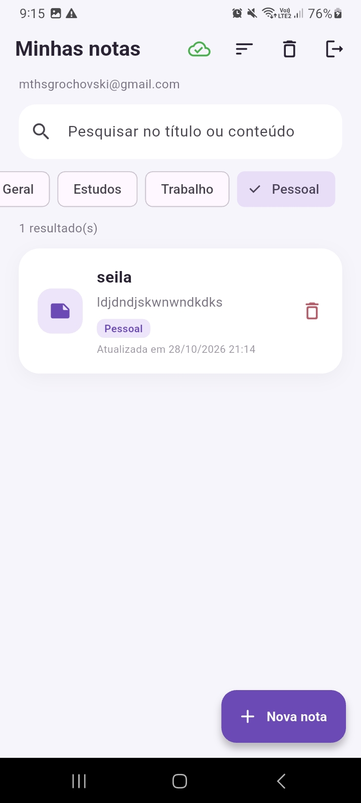 |

### Lixeira e modo offline

| Lixeira com "Desfazer" | Offline: nota pendente e aviso de erro |
| --- | --- |
| 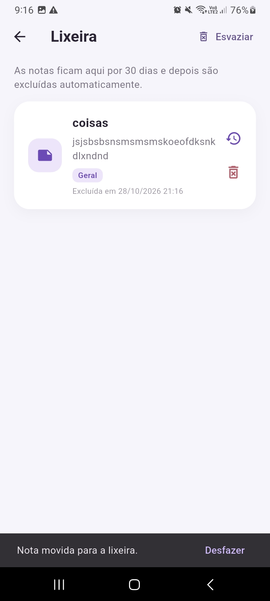 | 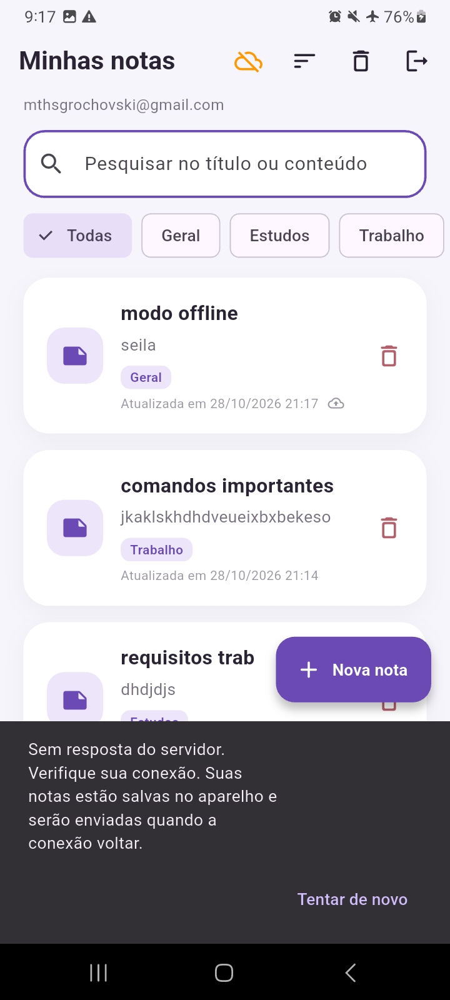 |

No print offline, com o modo avião ligado, o ícone de nuvem fica laranja, a
nota "modo offline" mostra o ícone de envio pendente e o app avisa que ela
ficou salva no aparelho. Ao reconectar, a nota é enviada ao Firestore.

### Evidências no Firebase

**Notas gravadas no Cloud Firestore** em `users/{uid}/notes/{id}`, com os
campos `uid`, `title`, `content`, `category`, `createdAt`, `updatedAt` e
`deletedAt`:

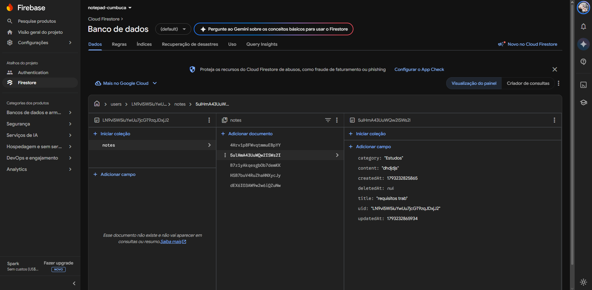

**Usuário cadastrado no Firebase Authentication.** O UID é o mesmo da pasta
`users/{uid}` no Firestore:

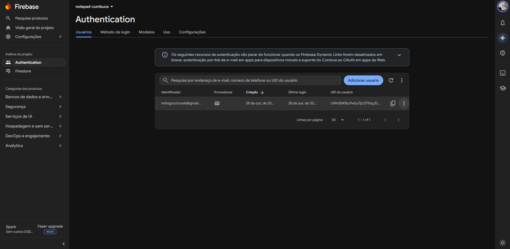

**Regras de segurança publicadas** (`firestore.rules`):

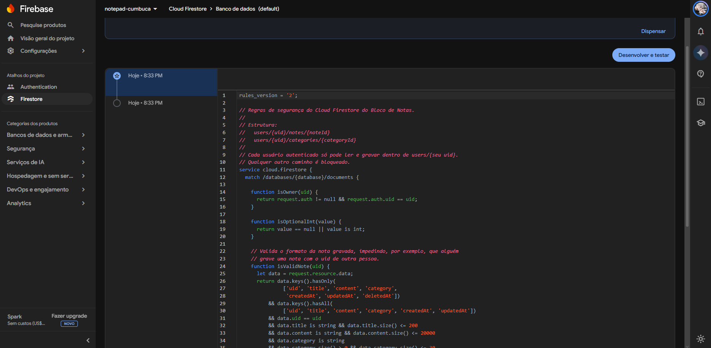

---

## 12. O que foi alterado nesta entrega

| Arquivo | Alteração |
| --- | --- |
| `pubspec.yaml` | Adicionado `cloud_firestore` |
| `lib/main.dart` | `AuthGate` (login persistente), Firestore sem cache próprio |
| `lib/models/note.dart` | Novos campos (`remoteId`, `category`, datas, lixeira, `syncStatus`) e conversões para o Firestore |
| `lib/models/note_category.dart` | **Novo** — modelo de categoria |
| `lib/database/database_helper.dart` | Banco v2 com migração, tabela de categorias, pesquisa, filtro, ordenação, lixeira e controle de pendências; corrigido o nome `instance` (antes `instace`/`ínstance`, que impedia a compilação) |
| `lib/services/firestore_service.dart` | **Novo** — acesso ao Firestore com tempo limite e tradução de erros |
| `lib/services/sync_service.dart` | **Novo** — sincronização push/pull e resolução de conflitos |
| `lib/repositories/note_repository.dart` | **Novo** — repositório usado pelas telas |
| `lib/services/auth_service.dart` | Stream de autenticação e mensagens de erro em português |
| `lib/screens/notes_page.dart` | Pesquisa, chips de categoria, ordenação, ícone de sincronização, lixeira, puxar para atualizar |
| `lib/screens/note_form_page.dart` | Seleção e criação de categoria; usa o repositório |
| `lib/screens/trash_page.dart` | **Novo** — lixeira com recuperação |
| `lib/screens/login_page.dart`, `register_page.dart` | Navegação pelo `AuthGate` e mensagens de erro |
| `lib/widgets/*` | Cartão com categoria/pendência, botão de sincronização, diálogo de categoria |
| `firestore.rules`, `firebase.json` | **Novo** — regras de segurança e configuração para publicá-las |
| `lib/firebase_options.dart`, `android/app/google-services.json` | App reconfigurado (`flutterfire configure`) para o projeto Firebase `notepad-cumbuca` |
| `android/app/build.gradle.kts` | Versão do Android NDK fixada em `30.0.16248370` (a versão instalada no ambiente de desenvolvimento) |
| `docs/screenshots/` | **Novo** — capturas do app e do console do Firebase |
| `test/sync_logic_test.dart` | **Novo** — testes unitários |

---

Desenvolvido por **Matheus Grochovski** para a disciplina de desenvolvimento
mobile.
